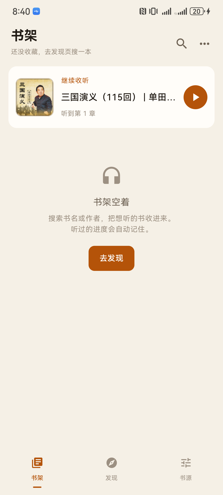
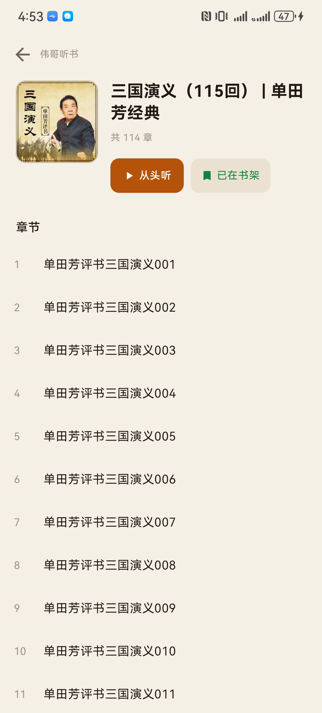
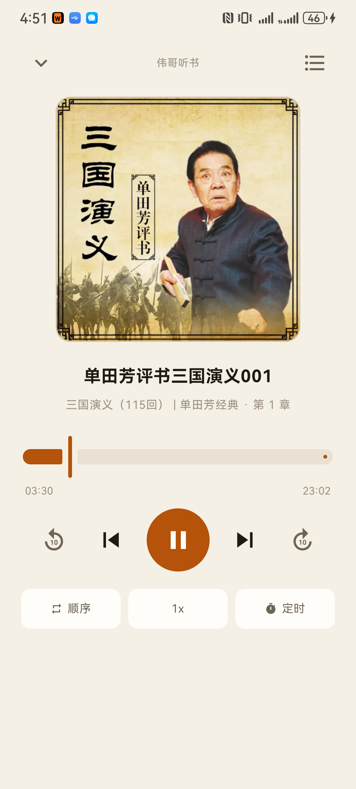
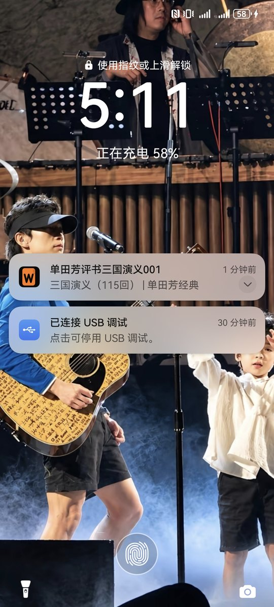

# 伟哥听书

Android 听书 App。装上就能搜、就能听，不用配置任何书源——内容直接走喜马拉雅接口，只显示**免费**专辑。

> 个人自用项目，内容版权归喜马拉雅所有，仅供学习与自用，请勿商用。

## 功能

| 能力 | 说明 |
|---|---|
| 搜索 | 搜专辑即搜书；付费/会员专辑在数据层就被过滤，列表里不会出现 |
| 章节 | 专辑音轨自动翻页取全（一页 20 条，最多 60 页），点哪章听哪章 |
| 后台播放 | `MediaSessionService` 接管通知栏、锁屏、耳机键，息屏不断 |
| 断点续播 | 按「书 + 章节」存毫秒级进度，杀进程重进也能接着听 |
| 倍速 / 定时 | 0.5×–3×，15/30/60/90 分钟或「本章播完就停」 |
| 播放模式 | 顺序 / 单章循环 / 随机 |
| 主题 | 夜间暖黑 + 琥珀，白天米白 + 深琥珀 |
| 深链 | `weigetingshu://album/<albumId>` 直接打开专辑 |

## 截图

| 书架 | 详情 | 播放 | 锁屏 |
|---|---|---|---|
|  |  |  |  |

图标：一本书，封面上刻着 W（「伟」的首字母）。


## 下载

最新安装包见 [Releases](https://github.com/qilin892/WeiGe-tingshu/releases)。当前版本 `1.3.2`（release 签名，R8 压缩后 2.46 MB）。

仓库：<https://github.com/qilin892/WeiGe-tingshu>

## 构建

需要 JDK 17 + Android SDK（compileSdk 35）。

```bash
cd android
echo "sdk.dir=/path/to/Android/sdk" > local.properties

./gradlew assembleDebug     # 调试版，约 21 MB
./gradlew assembleRelease   # 发布版，R8 压缩后约 2.5 MB
```

发布版签名读 `android/keystore.properties`（不进仓库）：

```properties
storeFile=keystore/weige-tingshu.jks
storePassword=******
keyAlias=weige
keyPassword=******
```

没有这个文件时，release 会退回 debug 签名——别人 clone 下来也能直接构建，只是不能覆盖安装
已发布的包（签名不同）。**自己发布的包必须用同一把密钥签后续版本**，否则用户只能卸载重装。

## 结构

```
android/           Android 工程（Kotlin + Compose + Media3）
  app/src/main/java/com/weige/tingshu/
    source/Ximalaya.kt     内置的喜马拉雅客户端：搜索 / 音轨翻页 / 免费过滤
    source/Providers.kt    统一取书入口，界面与播放服务只认它
    source/Covers.kt       封面按用途分档取图（300 / 640 / 960）
    play/                  MediaSessionService、播放控制器、通知
    ui/                    书架、发现、详情、播放四个界面
docs/              技术笔记
preview/           截图与界面预览页
tools/             开发小工具（图标预览渲染、真机按文字点按）
```

## 技术要点

- **接口写死在代码里**，不依赖可配置的书源：搜索 `revision/search`，音轨 `mobwsa…/playlist/album/page`，
  返回的 `playUrl64` 是不带时效的 mp3 直链，不用「要播才解析」那一步。
- **收费过滤**：搜索层剔 `is_paid=true` / `vipFreeType≠0` 的专辑，章节层剔三个 `playUrl` 全空的音轨。
- **播放**：Media3 + 自定义 `NotificationProvider`。通知 channel 用 `IMPORTANCE_DEFAULT` + `VISIBILITY_PUBLIC`，
  这是华为/小米上锁屏能显示封面的必要条件（用 LOW 会被折叠）。
- 细节与踩坑记录见 [android/README.md](android/README.md)。

## 声明

本项目不存储、不分发任何音频文件，播放地址由喜马拉雅接口实时返回；所有内容版权归原权利方所有。
请勿用于商业用途，也不要用于绕过付费内容。
