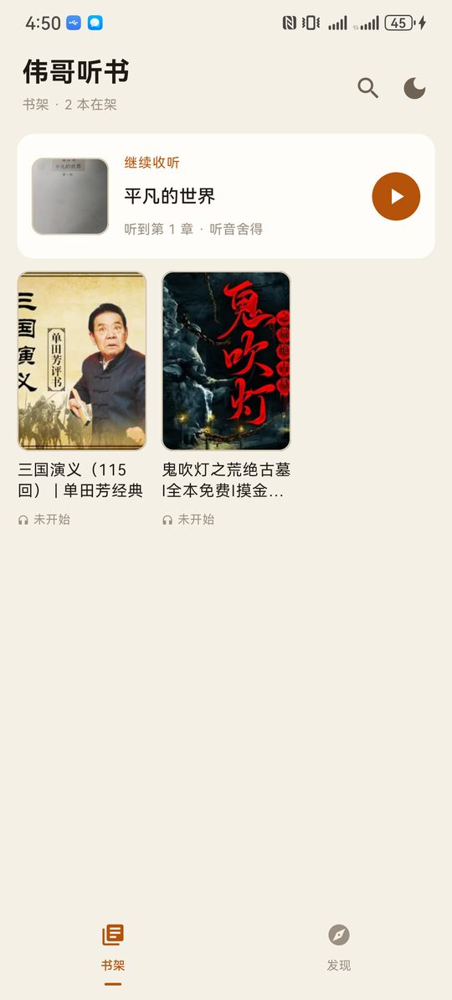
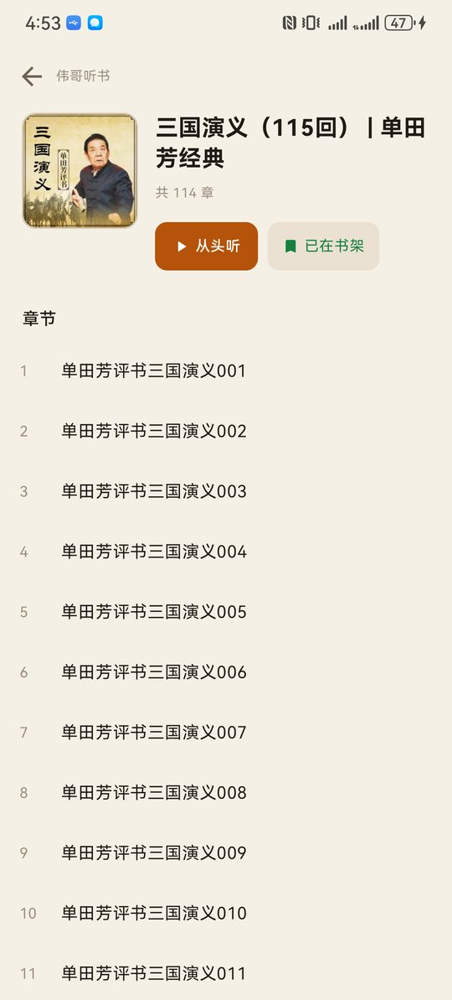
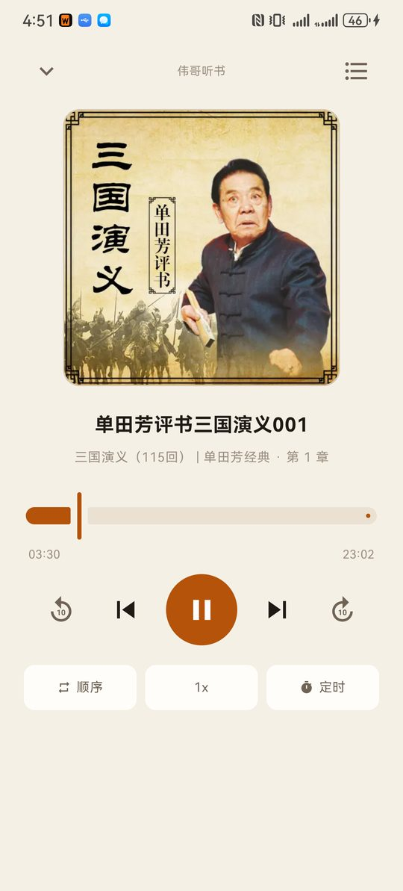
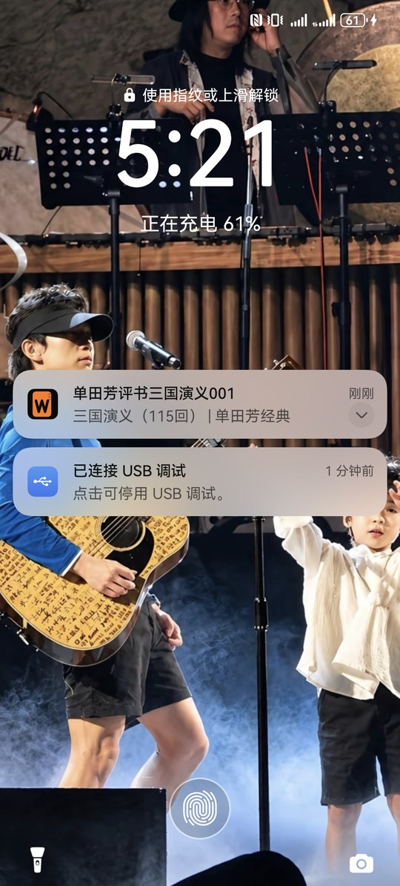

# 伟哥听书

Android 听书 App。装上就能搜、就能听，不用配置任何书源。内容走喜马拉雅接口，只显示免费专辑。

## 功能

- **搜索**：搜专辑就是搜书，收费专辑直接不显示
- **播放**：后台播放、锁屏可控制、杀掉进程也能接着听
- **倍速 0.5×–3×**，睡眠定时（15/30/60/90 分钟，或本章播完就停）
- **顺序 / 单章循环 / 随机**三种播放模式
- 冷暖和夜间两套配色
- 深链打开专辑：`weigetingshu://album/<专辑ID>`

## 截图

| 书架 | 详情 | 播放 | 锁屏 |
|---|---|---|---|
|  |  |  |  |

## 下载

[Releases](https://github.com/qilin892/WeiGe-tingshu/releases) · 当前版本 `1.3.3` · 2.46 MB · Android 8.0+

## 构建

需要 JDK 17 和 Android SDK（compileSdk 35）。

```bash
cd android
echo "sdk.dir=/path/to/Android/sdk" > local.properties
./gradlew assembleRelease
```

发布版签名读 `android/keystore.properties`；没有这个文件时退回 debug 签名，所以拉下来就能直接构建。

## 说明

不存音频、不转发文件，播放地址由接口实时返回。内容版权归原权利方，仅供学习自用，别商用、也别用来绕过付费。
